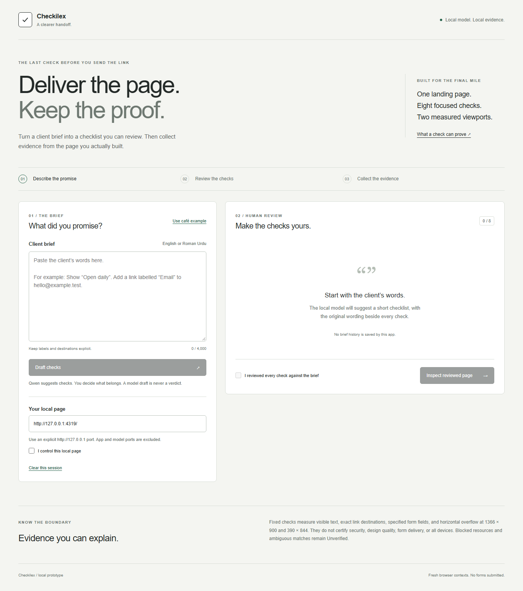
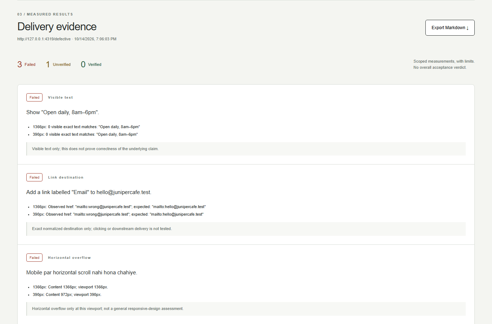

# Checkilex

A local delivery checklist for freelance web developers. Paste an English or
Roman Urdu brief, review the proposed checks, and inspect one page you control.
Download a Markdown report and desktop/mobile evidence.



Qwen proposes data. Fixed Playwright checks measure the page. Review is mandatory:
the small model can misread requirements, and this is a prototype.

## Run on Windows

Tested with Node 24.13.0, Ollama 0.40.0, Qwen3 1.7B and Playwright 1.63.0.
Use three PowerShell terminals in this repository.

First install the packages:

```powershell
npm ci
```

The runtime launcher expects a resource directory containing:

```text
resources/
  ollama-v0.40.0/ollama.exe
  ollama-v0.40.0/lib/...
  models/...
  browsers/chromium_headless_shell-1243/chrome-headless-shell-win64/chrome-headless-shell.exe
```

Download and extract the Windows runtime from the
[Ollama release](https://github.com/ollama/ollama/releases/tag/v0.40.0).
Set `SDC_RESOURCES` in each terminal to your resource directory. Install the
matching browser and start the isolated model server:

```powershell
$env:SDC_RESOURCES = 'D:\path\to\resources'
$env:PLAYWRIGHT_BROWSERS_PATH = Join-Path $env:SDC_RESOURCES 'browsers'
npx playwright install chromium
npm run model
```

The launcher binds to 127.0.0.1:11434, disables Ollama cloud features and uses a
fresh ignored profile. If that port is occupied, stop your existing runtime
yourself or use it only after checking its configuration. The launcher does not
take over another process.

In terminal two, download the model once, then build and run the app:

```powershell
$env:SDC_RESOURCES = 'D:\path\to\resources'
$env:OLLAMA_HOST = '127.0.0.1:11434'
& "$env:SDC_RESOURCES\ollama-v0.40.0\ollama.exe" pull qwen3:1.7b
npm run build
npm run dev -- --production
```

In terminal three, run the fictional café:

```powershell
npm run fixture
```

Open **http://127.0.0.1:4318**. Choose **Use café example**, draft and review the
checks, confirm page ownership, then inspect. Change the target to
`http://127.0.0.1:4319/defective` to see planted failures. Download PNGs beside
the exported Markdown file. Ctrl+C stops each terminal's service.

On this laptop the preserved resources already live at
`D:\Programming\Open_Source\hacktoberfest-week2-resources`, which is the
default when `SDC_RESOURCES` is unset. `SDC_CHROMIUM` can override the browser
executable. Neither setting changes the fixed local model endpoint.

[Watch the real synthetic-data walkthrough](docs/demo.webm) or read the
[demo notes](docs/demo.md). The video was recorded before the Checkilex rename.
Current screenshots replay its recorded model draft and collect fresh browser evidence.



## What the report means

| Outcome | Meaning |
| --- | --- |
| Verified | The stated narrow measurement passed at both recorded sizes. |
| Failed | A measurable requirement failed at one or both sizes. |
| Unverified | The promise needs manual proof, matching was ambiguous, or resources were blocked. |

Checks cover quoted visible text, exact normalized link destinations, labelled
form-field structure and horizontal overflow at 1366 × 900 and 390 × 844.
Form fields do not prove message delivery. No form is submitted and no link
destination is visited. A report is not an overall acceptance certificate.

Quote literal page text and link labels in the brief. Missing details, optional
work and unsupported promises belong in manual review. Add or edit checks when
the model omits something. Eight reviewed checks are supported; large AI drafts
can hit the 45-second timeout on the tested CPU.

The inspector accepts only an explicit `http://127.0.0.1:PORT` target, excluding
app/model ports. Fresh browser contexts block cross-origin HTTP requests,
redirects, non-read methods, WebSockets, service workers, popups and downloads.
Requests and response bytes are bounded. This is browser request control, not an
operating-system network sandbox; inspect your own local development pages.

## Evidence and limits

See [evaluation results](docs/evaluation.md), [raw evidence](docs/evidence/),
and [demo instructions](docs/demo.md). All fixtures and measurements use synthetic
data. No customer, payment or time-saving claim has been validated.

The original held-out result was **12/16 (75%)**, versus **14/16 (87.5%)** for
the keyword baseline. It missed the planned accuracy and improvement targets.
The original eight-check request timed out at 45 seconds. The revised complete pipeline mapped 16/16 fresh synthetic cases, compared
with 11/16 for keywords using the same grounding rules. These small targeted
sets do not establish general reliability. The revision and its
separate frozen holdout are documented with those original results retained.

```powershell
npm test
npm run test:browser
npm run typecheck
npm run build
node scripts/run-evaluation-v2.ts
```

Model-free checks run without inference. Evaluation requires the local model and
the separate fixture server. Dependency installation and production bundling were
also verified in an isolated directory; a fresh Windows installation and fresh
model/browser downloads have not been tested.

The app keeps its current brief and report in memory. It does not save history,
use cookies, send telemetry, or store briefs in browser storage. Clear the
session or reload to discard the UI state. Ollama may retain its local inference
context until unloading; this is not secure erasure. Explicit downloads remain
on disk until you delete them. Setup downloads require internet access.

Maintainer: Huzaifa Abdul Rehman. Report reproducible issues without real client
data. [MIT licence](LICENSE); [third-party notices](THIRD_PARTY_NOTICES.md).
