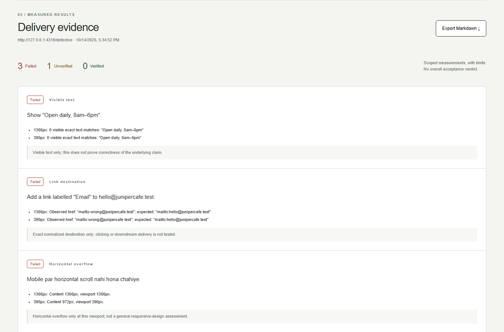

# Demo

[Watch the actual walkthrough](demo.webm) (WebM, 45.08 seconds, silent).

The recording uses the real production UI, local Qwen inference and fixed
Playwright inspection. It is automated operation of review controls with
synthetic expected checks, not a customer session. No inference wait was cut:
drafting takes 32.1 seconds. The video and original captures below retain the
pre-rename name, Site Delivery Check. Pause to inspect the checklist and results.

The walkthrough switches between two fictional fixtures; it does not show an
automatic code repair. The defective page yields three Failed checks and one
Unverified delivery promise. The good page yields three Verified checks and
the same Unverified promise. A separate fixture test also covers form structure.

The original brief includes Roman Urdu mobile-scroll wording. Every screenshot
comes from the running app; none is a generated mockup.

- [Review screen](screenshots/app-review.png)
- [Complete defective-page report](screenshots/app-report-full.png)
- [Mobile report](screenshots/app-report-mobile.png)
- [Good-page report](screenshots/app-report-good.png)
- [Actual model-unavailable state](screenshots/app-model-unavailable.png)
- [Exported Markdown](screenshots/site-delivery-report.md), with its two PNGs
- [Raw walkthrough evidence](evidence/demo-run.json)

All images were visually inspected. Four decoded video frames were inspected
at 2, 20, 36 and 43 seconds; automated assertions also checked the actual draft,
both inspection responses and removal of results after a target edit.

Current Checkilex captures: [desktop](screenshots/checkilex-start-desktop.png),
[mobile](screenshots/checkilex-start-mobile.png),
[desktop report](screenshots/checkilex-report-desktop.png) and
[mobile report](screenshots/checkilex-report-mobile.png). These replay the recorded
synthetic draft and collect fresh browser measurements; no new inference timing
is claimed.

To recapture, start the app, local model and café fixture using the README,
then run `node scripts/capture-demo.ts`. The script expects a clean synthetic
session and overwrites the demo artifacts. The native WebM format avoids adding
a new video dependency; the available FFmpeg build has no H.264 encoder.
