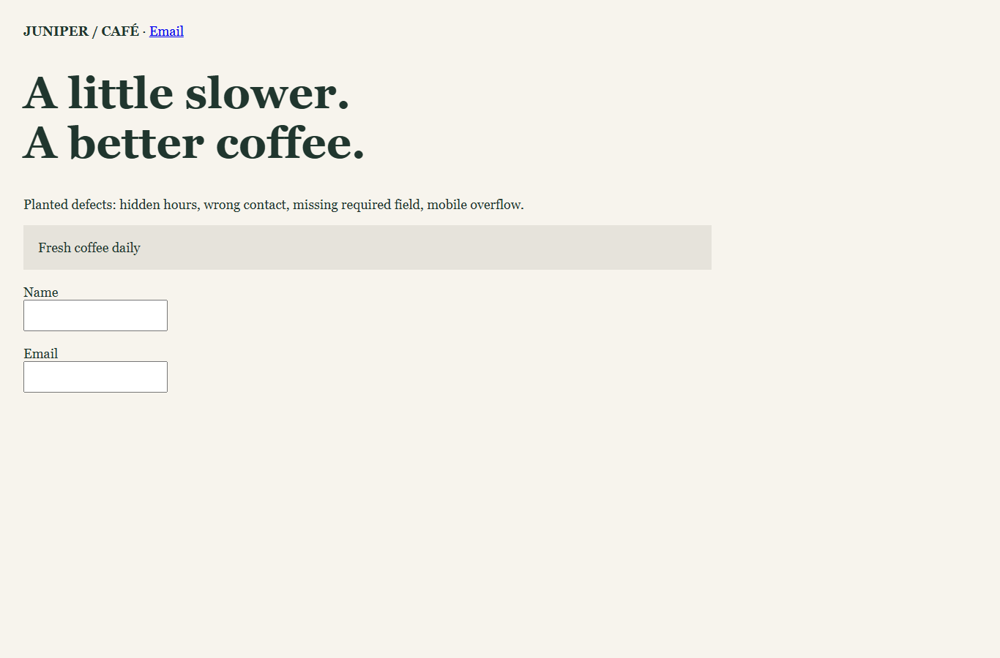
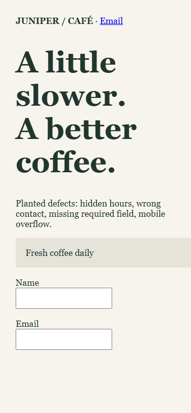

# Site Delivery Check

Target: http://127\.0\.0\.1:4319/defective

Checked: 2026\-10\-14T12:34:52\.581Z

Input fingerprint: 373f1acf482d3bac160569547b7b5172720ddcada9c96f6d607c094f9fe82548

These results cover reviewed checks at 1366 × 900 and 390 × 844. They are not a complete acceptance certificate.

## Failed — c1

> Show "Open daily, 8am–6pm"\.

Measured facts:

- 1366px: 0 visible exact text matches: "Open daily, 8am–6pm"
- 390px: 0 visible exact text matches: "Open daily, 8am–6pm"

Limits:

- Visible text only; this does not prove correctness of the underlying claim\.

## Failed — c2

> Add a link labelled "Email" to hello@junipercafe\.test\.

Measured facts:

- 1366px: Observed href: "mailto:wrong@junipercafe\.test"; expected: "mailto:hello@junipercafe\.test"
- 390px: Observed href: "mailto:wrong@junipercafe\.test"; expected: "mailto:hello@junipercafe\.test"

Limits:

- Exact normalized destination only; clicking or downstream delivery is not tested\.

## Failed — c3

> Mobile par horizontal scroll nahi hona chahiye\.

Measured facts:

- 1366px: Content 1366px; viewport 1366px\.
- 390px: Content 972px; viewport 390px\.

Limits:

- Horizontal overflow only at this viewport; not a general responsive\-design assessment\.

## Unverified — c4

> Contact form must deliver email\.

Measured facts:

- 1366px: No automated measurement supports this promise\.
- 390px: No automated measurement supports this promise\.

Limits:

- Requires an actual delivery test outside this inspector\.

## Captures

Download the accompanying PNG files from the application.

Versions: chromium 153\.0\.8010\.12; playwright 1\.63\.0
